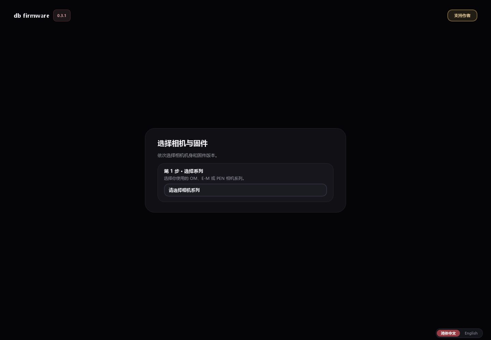
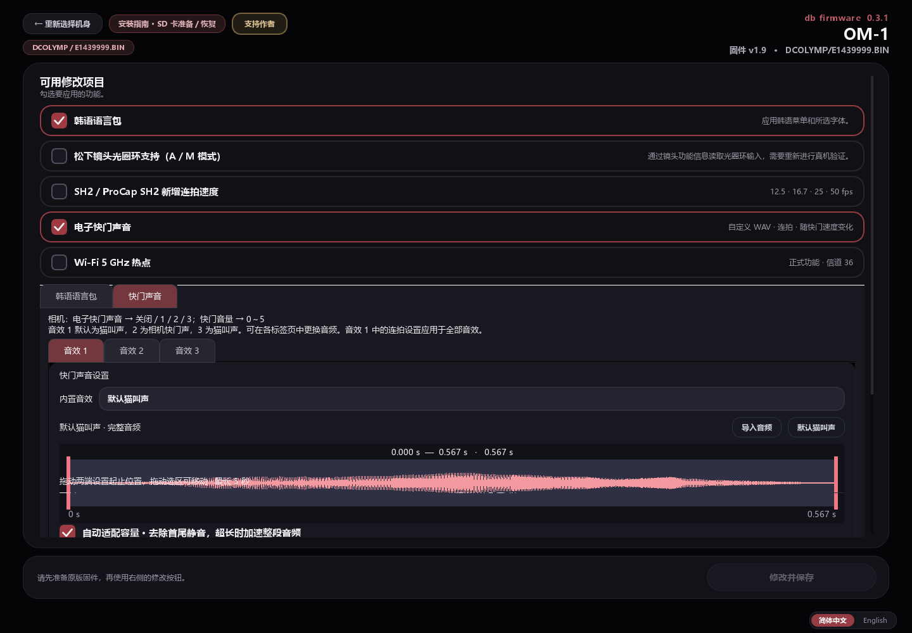

# db firmware 简体中文界面

基于 [azqeurio/om-c-firmware 的 v0.3.1 beta Windows 发布版](https://github.com/azqeurio/om-c-firmware/releases/tag/dbv0.3.1beta)制作的电脑工具界面汉化。

## 使用

从 [简体中文版 Release](https://github.com/Toshihiko-Lin/zh-om-c-firmware/releases/tag/zh-v0.3.1-1) 下载 `db-firmware-0.3.1-zh-CN.exe`，双击即可运行，无需安装 Python。适用于 Windows x64。自行构建的程序位于 `dist/` 目录。

界面右下角可以在简体中文和 English 之间切换。中文版使用独立的语言偏好设置，首次运行默认中文。

已翻译机身／版本选择、修改项目说明、字体编辑控件、声音设置、安装指南、进度提示和确认弹窗。中文界面使用 Windows 微软雅黑。

“韩语语言包”仍是原工具提供的相机韩语功能。相机菜单、韩文预览样例和固件输出语言不会因工具界面汉化而变成中文。底层固件模块的原始诊断信息可能仍为韩文或英文。





## 实现与校验

上游没有公开程序源码。本项目读取 PyInstaller 归档中的 Python 3.12 代码对象，按精确文本映射替换界面字符串，再重新打包；不需要恢复完整源码，也不直接修改字节码指令。保留原作者名称、版本号和赞助入口。

只替换 `app`、`i18n`、`sound_panel` 三个界面模块，以及程序启动入口。构建后逐项验证其他 807 个 Python 模块和 407 个归档文件与原版一致，包括固件生成模块、`profiles.json`、相机语言资源、字体和补丁数据。

翻译保存在 `localization/`。`tools/build_zh.py` 是本项目编写的构建脚本，不是原作者源码。`dist/build-report.json` 记录输入、输出 SHA-256 和一致性检查结果。

此次发布的校验记录见 [构建报告](docs/verification/build-report.json) 和 [界面自测报告](docs/verification/ui-report.json)。23 个机型配置的界面自测通过，检查到的可见控件没有残留韩文。韩语语言包中的菜单原文和预览样例按原版保留，不属于电脑界面的翻译范围。

## 重新构建

需要 Windows 和 Python 3.12；构建过程仅使用 Python 标准库。

在仓库根目录执行 PowerShell：

```powershell
New-Item -ItemType Directory -Force upstream-releases | Out-Null
Invoke-WebRequest -Uri 'https://github.com/azqeurio/om-c-firmware/releases/download/dbv0.3.1beta/db.firmware.0.3.1.exe' -OutFile 'upstream-releases/db.firmware.0.3.1.exe'
python tools/build_zh.py
```

构建脚本固定校验上游文件 SHA-256：

```text
e30c019b3179d12c16abaa7ec03a4d2b75e8d647bf5f15ab9ca043098cb1ae43
```

其他版本或其他内容的 EXE 会被拒绝，不能直接套用此补丁。

## 界面自测

```powershell
& './dist/db-firmware-0.3.1-zh-CN.exe' --zh-ui-test './dist/qa'
```

自测在离屏环境中创建界面，遍历全部机型配置，检查可见控件的韩文残留、中英切换及清空 SD 卡确认框的默认／退出按钮，并保存页面截图和 `ui-report.json`。测试设置单独存放在测试目录。

自测不下载固件、不生成固件、不复制文件到 SD 卡，也不执行清空或刷机操作。相机实际修改及安装功能未作真机测试。

原版下载文件、生成的 EXE 和完整测试截图通过 `.gitignore` 排除，不提交到 Git 历史。中文版 EXE、SHA-256 校验文件和构建报告通过 Releases 分发；仓库中保留选取的界面截图和验证报告。

## 来源与版本范围

本项目为第三方界面汉化，非 OM SYSTEM 官方软件，也不是原作者发布的官方中文版。原程序与功能归原作者所有，原作者仓库及发布入口见本文开头。本项目不宣称拥有上游程序源码。

此汉化仅适用于上文固定 SHA-256 的 v0.3.1 beta Windows 发布版。界面自测和资源一致性检查不等于相机固件功能验证；本项目没有新增机型兼容性承诺，也没有进行真机刷写测试。
